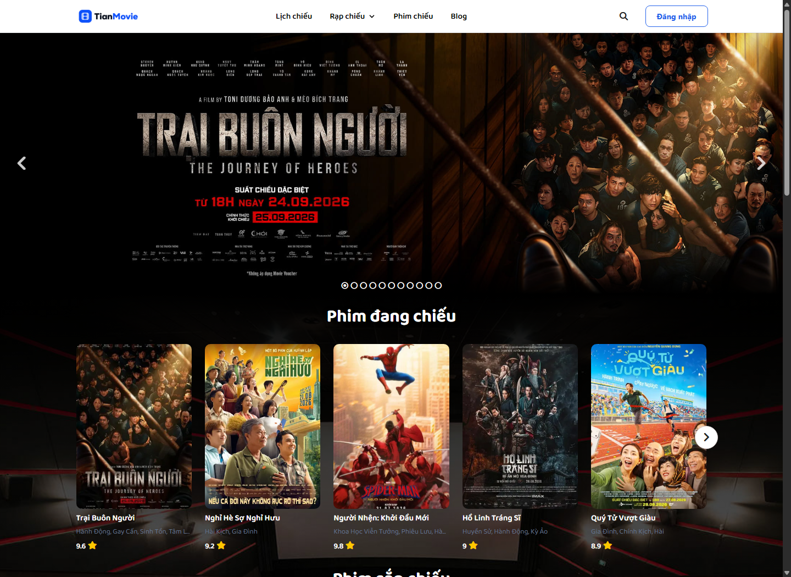
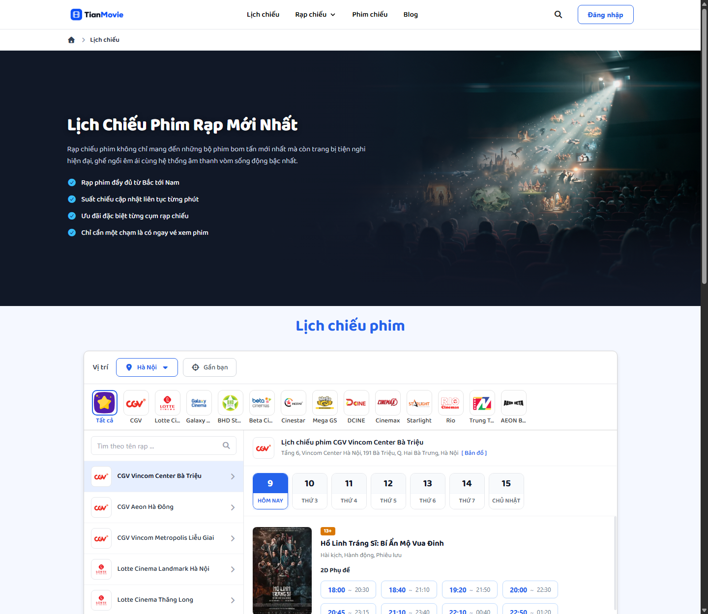
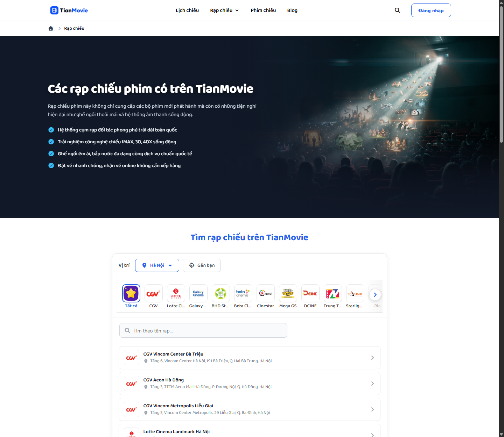
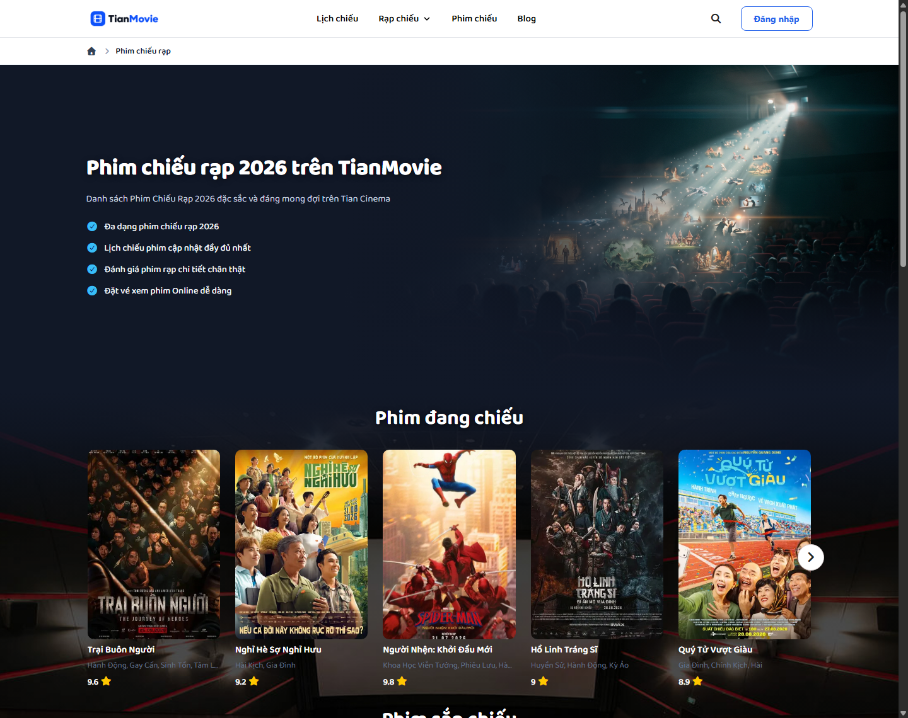
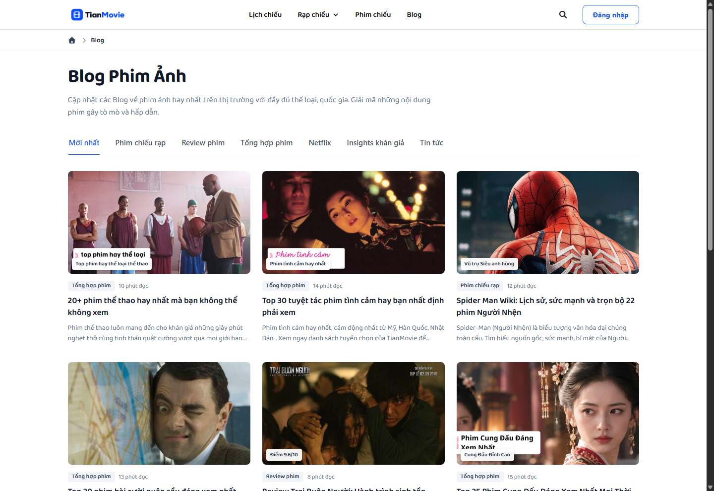
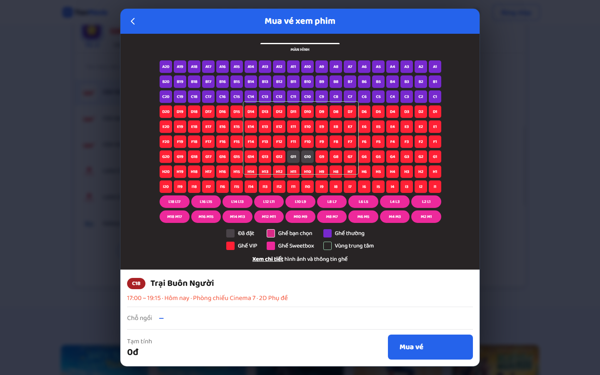
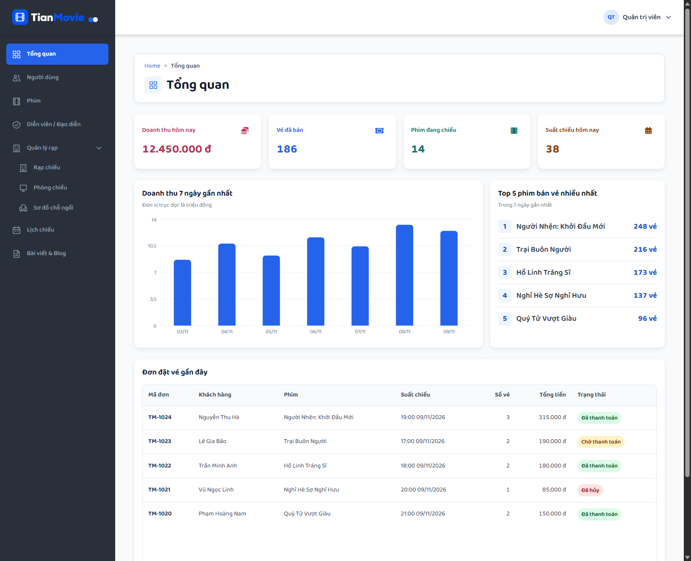

# TianMovie

TianMovie là dự án website xem lịch chiếu và đặt vé xem phim, gồm giao diện dành cho khách và khu vực quản trị. Phiên bản hiện tại là bản demo frontend chạy bằng dữ liệu mẫu.

## Tính năng hiện có

### Giao diện khách hàng

- **Trang chủ** có banner phim nổi bật, danh sách phim đang chiếu, phim sắp chiếu và bài viết.
- **Lịch chiếu** cho phép chọn thành phố, rạp và ngày để xem các suất chiếu mẫu. Bấm giờ chiếu để mở popup chọn ghế.
- **Rạp chiếu** cho phép lọc theo thành phố, thương hiệu hoặc tên rạp. Có thể mở trang chi tiết của từng rạp.
- **Phim chiếu** có danh sách phim đang chiếu, phim sắp chiếu và bộ lọc tìm phim. Trang chi tiết hiển thị nội dung, thời lượng, diễn viên và lịch chiếu mẫu.
- **Blog** có các chuyên mục phim ảnh, danh sách bài viết và trang đọc chi tiết.
- **Popup chọn ghế** hiển thị ghế thường, ghế VIP, ghế đôi và ghế đã đặt. Khi chọn ghế, giao diện cập nhật số ghế và tiền tạm tính.

### Khu vực quản trị

- **Dashboard** có thẻ thống kê, biểu đồ doanh thu 7 ngày, top phim bán vé và đơn đặt vé gần đây.
- **Danh sách quản lý** gồm người dùng, phim, diễn viên và đạo diễn, rạp, phòng chiếu, sơ đồ chỗ ngồi, lịch chiếu và bài viết.
- **Điều hướng** dùng sidebar phân cấp. Các bảng danh sách dùng phân trang tối đa 8 dòng. Trang Sơ đồ chỗ ngồi có bộ lọc theo rạp.

### Trạng thái dự án

Các trang hiện sử dụng dữ liệu mẫu. Form đăng nhập, nút **Mua vé** và các nút **Thêm, Sửa, Xóa** trong admin đang ở mức giao diện. Phần API, cơ sở dữ liệu, phân quyền, đặt vé và thanh toán sẽ được triển khai ở các bước tiếp theo.

## Ảnh giao diện

Ảnh chụp từ frontend TianMovie chạy trên máy với dữ liệu mẫu.

### Trang chủ



### Lịch chiếu



### Rạp chiếu



### Phim chiếu



### Blog



### Chọn ghế



### Dashboard quản trị



## Công nghệ

- React và Vite
- React Router
- CSS Modules
- Recharts và Font Awesome

## Chạy trên máy

Cài Node.js 24 và npm, sau đó chạy các lệnh sau từ thư mục gốc của repo.

```bash
cd frontend
npm ci
npm run dev
```

Mở địa chỉ Vite in ra trong terminal. Thông thường đó là `http://localhost:5173`.

### Các đường dẫn chính

| Khu vực | Đường dẫn |
| --- | --- |
| Trang chủ | `/` |
| Lịch chiếu | `/lich-chieu` |
| Rạp chiếu | `/rap-chieu` |
| Phim chiếu | `/phim-chieu` |
| Blog | `/blog` |
| Quản trị | `/admin`, tự chuyển sang `/admin/dashboard` |

| Mục quản trị | Đường dẫn |
| --- | --- |
| Tổng quan | `/admin/dashboard` |
| Người dùng | `/admin/user` |
| Phim | `/admin/movie` |
| Diễn viên / Đạo diễn | `/admin/people` |
| Rạp chiếu | `/admin/cinema` |
| Phòng chiếu | `/admin/rooms` |
| Sơ đồ chỗ ngồi | `/admin/seats` |
| Lịch chiếu | `/admin/screenings` |
| Bài viết & Blog | `/admin/blog` |

### Thử bản demo

1. Mở **Lịch chiếu**, chọn rạp và ngày, sau đó bấm vào một suất chiếu. Chọn một ghế còn trống để xem tiền tạm tính thay đổi.
2. Mở **Rạp chiếu**, đổi thương hiệu hoặc nhập tên rạp để xem danh sách được lọc.
3. Mở **Blog** và chọn một chuyên mục để xem nhóm bài viết tương ứng.
4. Mở `/admin` để xem dashboard. Chọn **Lịch chiếu** để thử phân trang hoặc mở **Quản lý rạp → Sơ đồ chỗ ngồi** để thử lọc theo rạp.

### Lệnh phát triển

Chạy các lệnh này trong thư mục `frontend`.

| Lệnh | Công dụng |
| --- | --- |
| `npm run dev` | Khởi động máy chủ phát triển |
| `npm run build` | Tạo bản build trong `frontend/dist/` |
| `npm run preview` | Xem thử bản build trên máy |
| `npm run lint` | Kiểm tra mã nguồn bằng ESLint |

## Cấu trúc

```text
frontend/
  src/
    admin/        Giao diện quản trị
    components/   Thành phần giao diện
    data/         Dữ liệu mẫu
    pages/        Các trang dành cho khách
    routes/       Cấu hình đường dẫn
docs/
  screenshots/   Ảnh chụp giao diện dùng trong README
```

Thư mục `backend/` dành cho phần máy chủ và hiện chưa có mã nguồn.

## Hướng phát triển

1. Khởi tạo backend, kết nối cơ sở dữ liệu và triển khai API danh sách phim.
2. Kết nối trang Phim với API, sau đó thêm đăng nhập và phân quyền quản trị.
3. Kết nối dữ liệu rạp, phòng, sơ đồ ghế và suất chiếu.
4. Hoàn thiện luồng giữ ghế, đặt vé và thanh toán.
